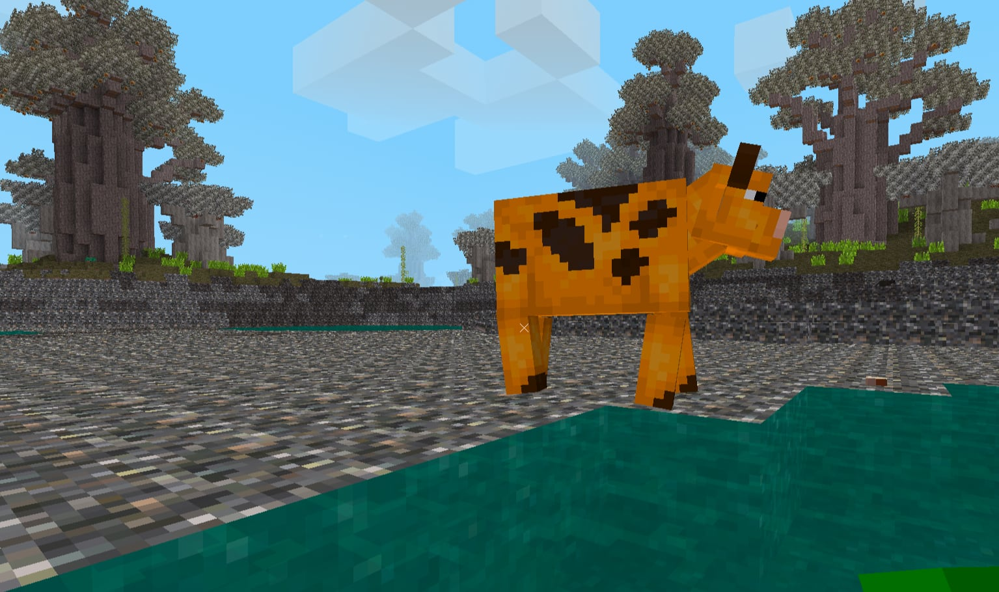

# Globo

`/sleep` to rest and regain energy. Being more sheltered will provide better rest

`/egg` to lay an egg. After sometime the egg will hatch and give the player a point

Play the game and enter your score on the [leaderboard](https://astera.getoutline.com/doc/leaderboard-Wgp93jcjIZ)

Check [commands.lua](mods/main/commands.lua) for a list of debugging commands. such as:
`/mob <animalname>` to spawn an animal at your location

## Installation

### Basic (for human play)

[Install minetest](https://www.minetest.net/downloads/).
Run:
```
minetest --version
```

Look for `STATIC_SHAREDIR` in the output.

Then you can sym-link or put this repo into  `<STATIC_SHAREDIR>/games/`.

E.g. if your CWD is inside this repo:

```sh
$(minetest --version | grep STATIC_SHAREDIR)
sudo mkdir -p $STATIC_SHAREDIR/games
sudo ln -s $STATIC_SHAREDIR/games/globo $(pwd)
```

And disable mod mod security (hopefully not needed long term):
```sh
echo '\nsecure.enable_security = false' >> ~/.minetest/minetest.conf
```

If that doesn't work you can disable it in the GUI before starting the game:

* Click Settings (button is in upper right of main menu)
* Show advanced settings (bottom right corner)
* Scroll down to "Developer options"
* Uncheck "enable mod security"

### With python gymnasium interface

1. Install [pixi](https://pixi.sh/latest/) or [micromamba](https://mamba.readthedocs.io/en/latest/installation/micromamba-installation.html) (can't use regular mamba with the private channel).
1. Get the prefix.dev key from [1Password](https://start.1password.com/open/i?a=I2R2ZJ47CNG4JMRZ6KYUHKKPOA&h=asterainstitute.1password.com&i=yesuo2guat53a7riiv4n7kcpya&v=5fznj7lifbm3qqmwvv6mde6upm).
1. Run:

```sh
pixi init --channel conda-forge --channel https://repo.prefix.dev/obelisk globo-env
cd globo-env
pixi auth login https://repo.prefix.dev --token <paste the password from 1Password here>
pixi add minetest-globo
```

Or, for Micromamba:
```
micromamba create -n globo-env
micromamba activate glob-env
micromamba auth login https://repo.prefix.dev --bearer <paste the password from 1Password here>
micromamba install -c https://repo.prefix.dev/obelisk minetest-globo
```

That should install minetest and this (Globo) game.


=======
## Gameplay

* The goal of the game is to lay as many eggs as possible without dying.

* The controls are standard Minecraft/Minetest controls. It is probably helpful to go through the Minetest tutorial first (can be downloaded as an extra game from within Minetest).

* You need to maintain several quantities above zero: health, hunger (i.e. hunger points, actually satiety), thirst and energy.

* “Health” is HP, reduced by critter attacks, falls, thorns, etc.. It recovers spontaneously.

* “Hunger” points slowly decrease. They’re replenished by food (fruits, killed critters, maybe others).

* “Energy” also slowly decreases and is replenished by sleeping - see below.

* There is an “Air” level. This might be related to swimming, as in Minecraft.

* Laying eggs (by typing /egg) increases hunger (i.e. decreases hunger points).

* To sleep, just type /sleep and stay put. Energy will recover. You wake up automatically by moving.

* At low energy, your physical abilities seem to decrease. For example, you can't jump a full block up. So ledges of one block are not climbable, and if you get into a one-deep hole, you're stuck until you /sleep and recover enough energy.

* There is also a “temperature”, indicated as X/Y where X is your body temperature and Y is the ambient temperature, in Celsius. I'm not sure how that works.

* For “thirst”, I couldn't find any water to drink. [Update: ice blocks, which look like low white slabs, can be picked and then eaten and reduce thirst.]

* You can hit critters by left-clicking on them. A very visible indicator of critter damage is shown (white checkerboard). When you are hurt, another indicator is shown (red flash). If you hit a critter enough they die. You can pick up their remains and then eat them. [Update: not any more, you can hit critters as long as you want and they won't die.]

* You pick things up by pointing at them and left-clicking (if they're close enough, and if you have an empty inventory slot).

* You use things by holding them in hand (selecting them in your inventory through the mouse wheel) and left-clicking. That’s also how you eat food.

* You can deposit items on the ground by holding them, pointing at the location and right-clicking.

* Some blocks can be dug out (left-click long enough) and picked up, others are undiggable. This is sometimes hard to predict by appearance, but immediately obvious when you just try to dig them (diggable blocks immediately change appearance and show projections),

* Inventory has only two slots. You can't pick up anything if your inventory is full.

* Note that somehow you can only put a maximum of two blocks of dirt in each inventory slot.

* Many blocks are "stairs" - you don't need to jump to go upwards on them.

* Plants can be picked up and then put back on the ground. This seems to have no effect. Some of them can presumably be eaten (e.g. potatoes).

* Like in Minecraft, navigating at night is hard. It's dark, though there are various light sources. Enemies seem no worse at night than during the day, unlike Minecraft.

* The GitHub page says you sleep better if you're sheltered. I'm not sure how you get shelter. Unlike Minecraft, it seems you can't build your own shelter - diggable blocks don't stay up if they're not supported (like Minecraft gravel / sand).

* The world is finite and small.

* Apparently there are some spontaneous eggs? Eggs can occur even if you have never typed /egg. From the text indications in the top left thee seem to be mob eggs (e.g. "mongoose_spawn").


## Environmental Elements of Globo

Before we begin talking about Astera-specific code, It's worth noting that Globo is descendent from [Exile](https://codeberg.org/Mantar/Exile), an open source mod for minetest.  All of us are new to that codebase and there will be mistakes in underastanding, incompleteness, and bugs that are already in place waiting to trip up your intuition.  Be open to inaccuracies and provide updates to this section as we all learn more.

### Air Temperature

Air temperature within Globo is managed through [mods/climate/temperature.lua](mods/climate/temperature.lua) around the following important functions:

- `climate.get_point_temp(pos, full)` returns the temperature at a given node
- `climate.air_temp_source(pos, temp_effect, temp_max, chance, timer)`  applies heat to the environment, such as from a torch, campfire, or lava
- `climate.air_temp_report(pos)` prints the temperature of all nodes around the provided position

The temperature of a given node is stored within the metadata of the node at `temp`.  The HUD in the lower left displays the current player's internal temperature and external temperature, respectively, at the `Temp:` label.

## Fauna

Animals exist within [mods/animals](mods/animals) and are defined both in [mods/animals/animalData.lua](mods/animals/animalData.lua) as well as a separate file that gets loaded within [mods/animals/init.lua](mods/animals/init.lua).  After defining all the necessary functions, a call to `minetest.register_entity` is then made to make the animal available to the game.

### LavaOx

A simple clone of the existing `cow` animal, the LavaOx is a red or orange tinted cow that spawns in the Dunelands biome.  It dumps heat into the air according to its configured `thermalGain` property.



