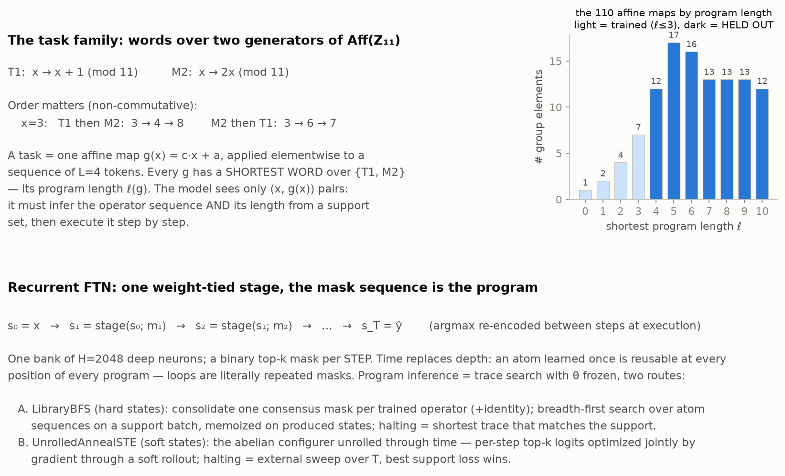
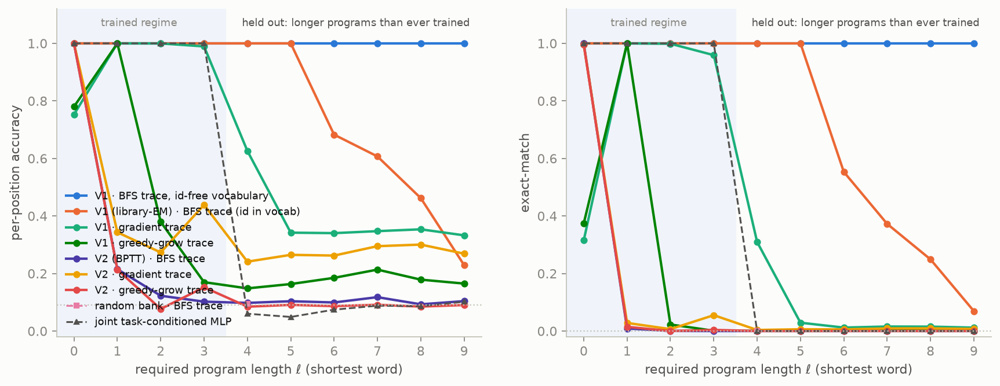
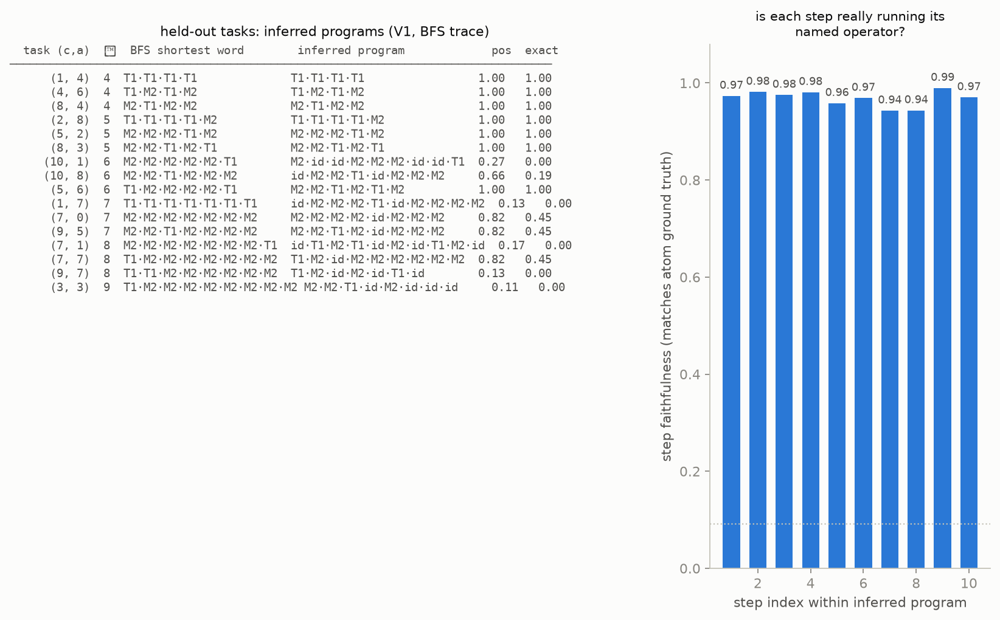
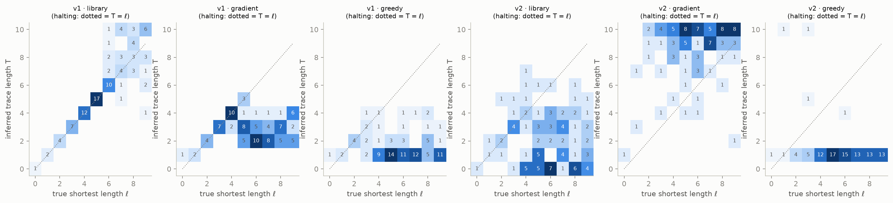
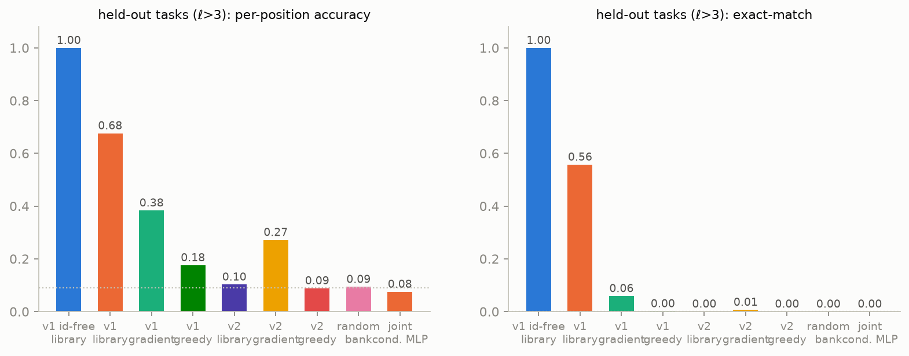

# Recurrent FTN: Temporal Selection for Non-Commutative Program Induction

**Run:** `results/main` (+ follow-ups `reeval_v1_noid`, `main_v2b`) · **Hardware:** actl pod `nar`, 1×H100 · **Predecessor:** `../abelian/RESULTS.md`

---

## 1. Question

The abelian-grid experiment established that FTN composes never-trained algorithms
by spatial selection — but its task family was deliberately commutative (order
could not matter) and its architecture fixed-depth (program length was capped).
This experiment invents the **recurrent FTN** and asks the questions the first
experiment could not:

- can a mask **sequence** over one weight-tied bank represent and execute
  **non-commutative** programs — where order must be inferred, not ignored?
- can the model **autonomously infer the operator sequence and its length**
  (halting) from a labeled support set alone?
- does it generalize to **programs longer than any ever trained** — the scale-OOD
  axis the first experiment designed out?

## 2. Task family: words over generators of Aff(Z₁₁)



A task is one affine map g(x) = c·x + a (mod 11), applied elementwise to L=4
token sequences. Tasks are reached as **words** over two generators — T1: x+1 and
M2: 2x (2 is a primitive root, so the two generators reach the entire 110-element
affine group). Composition is non-commutative: T1 then M2 gives 2x+2; M2 then T1
gives 2x+1.

Every map has a shortest word length ℓ(g) — its **program length** (BFS level
sizes: 1, 2, 4, 7, 12, 17, 16, 13, 13, 13 for ℓ = 0…9). **Training tasks: the 14
maps with ℓ ≤ 3** (identity, both generators, all short composites), trained
block-sequentially with no task identity, exactly as in the first experiment.
**Held out: all 84 maps with ℓ = 4…9** — every one requires a program longer than
any ever trained, up to 3× the training horizon. Inputs use the same 50/50 split
of the 11⁴ sequence space, so all reported numbers are input-OOD as well.
Chance = 0.091 per position, ~7·10⁻⁵ exact-match.

## 3. The machine: recurrent FTN

One canonical FTN stage (bank of H=2048 deep scalar neurons, k=256 top-k mask,
linear readout), **weight-tied across time**:

```
s₀ = x;   s_{t+1} = stage(s_t; m_t);   ŷ = s_T        (argmax re-encode between steps)
```

The mask sequence (m₁…m_T) IS the program; **time replaces depth**. This resolves
both limitations of FTN² at once: order is physically encoded by position in
time, and an operator learned once is reusable at every step of every program —
loops are literally repeated masks. As Kevin framed it: the machine does not
separate algorithm representation from execution trace; a program is represented
only by being run, and program inference is trace search.

**Two trainers** (the candidate-architecture axis):

- **V1 — library/EM (hard states).** Primitive tasks train like single FTN tasks.
  Composite blocks alternate: E-step = BFS trace search over consolidated atom
  masks on a support batch; M-step = BPTT through the soft rollout with the
  trace's masks fixed. Discrete search does credit assignment; gradients only
  refine operators.
- **V2 — BPTT-configured (soft states, fully general).** Every batch, an unrolled
  AnnealSTE configures all per-step masks by gradient through a soft rollout
  (length swept, no hints), and the weights update through it. The direct
  descendant of canonical per-batch reconfiguration.

**Three trace-inference routes at evaluation** (the candidate-algorithm axis),
all with frozen weights and only a support set, crossed with both trained banks:

- **A. LibraryBFS** — consensus atom masks as an action vocabulary; breadth-first
  search executing on the support with hard states, **memoized on produced
  support-states** (traces realizing the same group element collapse, so the
  search space is the 110-element group, not the 3^T tree). Halting is free:
  BFS returns the shortest trace that matches the support.
- **B. UnrolledAnnealSTE** — gradient trace search: T×H mask logits optimized
  jointly through the soft rollout; length by external T-sweep selected on hard
  support exact-match; best-of-3 restarts.
- **C. GreedyGrow** — library-free hill climbing: extend one step at a time,
  configuring only the new step's free mask toward the final target from the
  hard prefix state; halt on saturation.

## 4. Results

### 4.1 Headline: complete length generalization



**V1 with the final BFS route (id-free action vocabulary, §4.3) solves every
one of the 84 held-out tasks perfectly: 1.000 per-position, 1.000 exact-match,
the algebraically correct program 84/84, exact shortest-length halting 84/84 —
at every level ℓ = 4…9, i.e. programs up to 3× longer than any ever trained.**
All from 32 labeled examples per task, with zero weight updates, on input
sequences excluded from all training.

V1 held-out accuracy by required program length (per-position):

| ℓ | n | BFS (id-free) | BFS (id in vocab) | gradient | greedy |
|---|---|---|---|---|---|
| 4 | 12 | **1.000** | 1.000 | 0.63 | 0.15 |
| 5 | 17 | **1.000** | 1.000 | 0.34 | 0.16 |
| 6 | 16 | **1.000** | 0.683 | 0.34 | 0.19 |
| 7 | 13 | **1.000** | 0.607 | 0.35 | 0.21 |
| 8 | 13 | **1.000** | 0.462 | 0.35 | 0.18 |
| 9 | 13 | **1.000** | 0.229 | 0.33 | 0.17 |

Both controls sit at chance throughout the OOD regime (random bank 0.09; joint
task-conditioned MLP 0.997 on trained tasks, 0.08 held out — the standard-network
baseline memorizes and transfers nothing, again).

### 4.2 The programs are real programs



The inferred traces at ℓ ≤ 5 are letter-for-letter the BFS shortest words
(`M2·M2·M2·T1·M2` and the like). **Step faithfulness** — checking every executed
step against its named operator's ground truth — is 0.94–0.99 at every position:
the traces are faithful executions, not lucky terminal states.



Halting (inferred T vs true ℓ) is exact along the diagonal through ℓ = 6 for the
library route; the gradient route systematically truncates (mass below the
diagonal); greedy collapses to T = 1.

### 4.3 Failure analysis at ℓ ≥ 6: it's the identity atom, and it's fixable

Decomposing failures algebraically (collapse each inferred word to its group
element and compare against the target): **when the program is correct — 57 of
84 held-out tasks — execution averages 0.932 per-position even at depth 6–9.**
The correct-program rate by level is 12/12, 17/17, 11/16, 9/13, 6/13, 2/13:
the decay is a SEARCH phenomenon masking near-intact execution.

And the search failure has a specific mechanical cause visible in the program
table: failed traces contain spurious `id` insertions (`M2·id·id·M2·M2·M2·id·id·T1`).
The learned identity atom is only ~97% faithful per step, so each inserted `id`
perturbs the state slightly — which both defeats BFS's state memoization (nearly-
duplicate states no longer dedup) and lets id-padded best-effort traces outscore
the true program on a drifted support. Execution is NOT the bottleneck (step
faithfulness stays ≥0.94 through step 10); the **search vocabulary** is. Since
BFS halts by depth, the identity atom was never needed in its action set at all.

**Follow-up (id removed from the search vocabulary): the decay vanishes
entirely.** Re-evaluating the same frozen V1 bank with the two-generator action
set: 1.000/1.000 on all 84 held-out tasks, correct program 84/84, exact-length
halting 84/84 (`reeval_v1_noid.json`; the table in §4.1). One deleted dictionary
entry took held-out exact-match from 0.56 to 1.00 — the kind of failure analysis
a symbolic trace interface makes possible: the program table showed the id
insertions, the algebra located the fault in search rather than execution, and
the fix was surgical.

### 4.4 The trainer axis: V2's collapse at full scale

At smoke scale (2 cycles × 120 steps/task) V2 matched V1 — its bank + library
inference scored 1.000/1.000 on held-out tasks, and V2's bank was markedly more
*gradient-searchable* than V1's (0.61 vs 0.38 held-out, the trainer×inference
co-adaptation effect). At full scale (3 cycles × 300 steps/task) **V2 collapsed**:
its third cycle of per-batch gradient trace configuration progressively degraded
the primitive operators (training-time traces got noisier block by block), ending
with even the library route near chance. V1, whose E-step commits to discrete
traces and whose M-step only refines atoms, was immune.

This is the algorithm-representation-vs-execution-trace coupling made concrete:
when the trace search is itself stochastic and the weights chase its noise, more
training can mean worse operators. **Follow-up (V2 retrained at the smoke
schedule — 2 cycles × 200 steps — with the per-batch trace-search budget
doubled): the collapse persists** (`main_v2b`: trained tasks 0.14 library /
0.34 gradient; held-out 0.09/0.22 — never converged, wobbling from the first
cycle). Two schedules at H=2048 versus a clean success at H=512 localize the
failure to scale: per-batch gradient trace configuration cannot reliably find
traces in the larger mask space, so the weights are trained against noise from
the start. Fully-canonical temporal FTN training needs a stabilization
mechanism before it scales — trace commitment (anneal from stochastic traces
toward committed ones, i.e. interpolate toward V1's E-step), stronger/warmer
per-batch search, or curriculum freezing of consolidated atoms.

### 4.5 Methods summary (held-out, ℓ > 3)



| route | pos | exact |
|---|---|---|
| V1 · LibraryBFS (id-free, final) | **1.000** | **1.000** |
| V1 · LibraryBFS (id in vocab) | 0.68 | 0.56 |
| V1 · gradient | 0.38 | 0.06 |
| V1 · greedy | 0.18 | 0.00 |
| V2 · library / gradient / greedy | 0.10 / 0.27 / 0.09 | ~0 |
| random bank · LibraryBFS | 0.09 | 0.00 |
| joint task-conditioned MLP | 0.08 | 0.00 |

GreedyGrow's flat failure is itself informative: cross-entropy toward the final
target is deceptive along partial programs (no single step reduces it reliably),
so hill climbing has nothing to climb — trace search needs either library
structure (BFS) or joint optimization (unrolled gradient); there is no cheap
greedy middle.

## 5. What this establishes

**Established.**

1. **Temporal selection works.** A mask sequence over one weight-tied bank
   represents, infers, and executes non-commutative programs. Order is handled
   correctly (interleaved T1/M2 words where order changes the answer), and the
   same learned operator is reused at arbitrary positions — the property
   untied-depth architectures cannot have.
2. **Length generalization is complete**: 1.000/1.000 on all 84 never-trained
   programs, up to 3× the training horizon — the whole reachable group — with
   controls at chance. Scale OOD — deliberately designed out of experiment I —
   is now the headline claim.
3. **Autonomous halting is exact**: inferred trace length equals the shortest-
   word length on 84/84 held-out tasks, by search termination, not any oracle.
4. **The traces are faithful symbolic programs** — verifiable step by step
   against the generator semantics. FTN here is doing program induction in the
   literal sense: from 32 I/O examples to an executable, inspectable program.
5. **The population↔symbol spectrum has a measured shape.** Full fidelity to
   FTN's stochastic doctrine (V2 + gradient search) is the most general and the
   most fragile; a thin symbolic interface over the same distributed bank
   (consensus atoms + BFS) buys all of the length generalization. Canonicalize
   the atoms, compose by execution — the same lesson the abelian experiment's
   mask-algebra failure taught, now in positive form.

**Open.**

- Gradient-only trace search degrades with program length (joint coupling across
  steps); amortized or learned trace proposers are the natural next step.
- V2-style fully-general training needs a stability mechanism before it scales —
  candidates: trace-commitment schedules (anneal from gradient traces to
  committed traces), replay weighted toward primitives, or early stopping per
  block (the retrained schedule tests the simplest version).
- Internal halting (halt atom / ponder signal) vs the current external
  verification; richer generator sets; algorithms beyond group words
  (conditionals, data-dependent branching).

## 6. Reproduction

```bash
# on the actl pod `nar`, from /home/dev/workspace/temporal
uv run python run_temporal.py --config full --run main --variant both      # ~3.7 h
uv run python scripts/reeval.py main v1 noid                               # id-free BFS re-eval
uv run python run_temporal.py --config full --run main_v2b --variant v2 \
    --cycles 2 --steps-per-task 200                                        # V2 stability retrain
uv run --with python-pptx --with pillow python scripts/make_deck.py main
```

Code: `ftn_temporal/{config,tasks,model,configurer,train,evals,viz}.py`;
shared primitives in `nar/ftn_core/`. Artifacts under `temporal/results/<run>/`.
